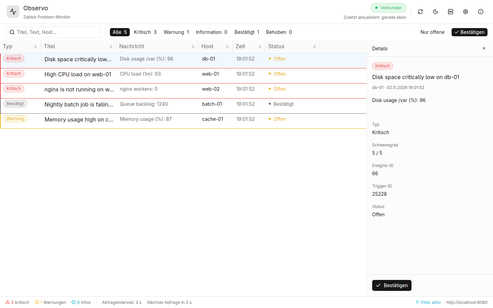

# Observo

A fast, native desktop client for **Zabbix** problems — rewritten from JavaFX to Rust and GPUI.

Observo polls a Zabbix server, shows active problems in a virtualised table, highlights
severity, and lets you acknowledge events with a comment. It is a single native binary,
starts in well under a second, and uses the GPU-accelerated [GPUI](https://gpui.rs) toolkit
through [GPUI Kit](https://gpui-kit.com).



## Features

- **Live problem table** with virtual scrolling, sorting, row selection and a details panel
- **Severity badges** for critical, warning, information, recovery and acknowledged problems
- **Search and filters** by title, message or host; “open only” and severity chips with counts
- **Acknowledge** any open event with an optional comment (double-click a row or use the detail panel), including a live character counter for Zabbix’s length limit
- **Connection status** with explicit online/connecting/offline state and a retry banner
- **System notifications and sound** for newly appeared critical/warning problems
- **Server configuration UI** with a real “Test connection” action, validation and password reveal
- **Settings** for German/English, system/light/dark theme, notifications, sound and close behaviour
- **Live language and theme switching** without restarting the application
- **Window geometry persistence**, maximized-state restore and safe fallback when a monitor is disconnected
- **Legacy migration** from the Java version’s `observo.properties`

### Why the rewrite

The JavaFX version worked, but the table was hard to scan and several runtime problems were
easy to hit. The Rust version keeps the same Zabbix integration while fixing, among others:

| Java version | Rust version |
| --- | --- |
| No HTTP timeouts; a hanging server blocked polling forever | Connect/global timeouts and bounded response sizes |
| Polling scheduler recreated on every start/restart, dead `lastPollInterval` field | One long-lived worker thread with a command channel and dynamic interval |
| Zabbix errors inserted as fake table rows | Errors are first-class state: offline badge, retry banner, last good data kept |
| Missing base resource bundle could crash on unsupported locales | Deterministic `selected → English → key` fallback |
| `eventid` silently fell back to `triggerid`, producing broken acknowledgements | Messages track `event_id` separately and only expose acknowledgement when valid |
| “Acknowledge” context menu was hard-coded English | All UI strings come from the translation bundles |
| Polling interval was only applied after editing the server config | Saved immediately and applied by the worker |
| Settings/password file was written with default permissions | Config file is written atomically with mode `0600` on Unix |
| Window could reopen off-screen after a monitor change | Position is sanitised and clamped to a sane range |
| No test-connection UI, no validation, no search, no details view | All included |

The old Java sources are kept under [`legacy-java/`](legacy-java/) for reference and migration.

## Requirements

- Rust **1.96** (pinned in [`rust-toolchain.toml`](rust-toolchain.toml))
- A working Vulkan driver and a graphical Wayland or X11 session
- Zabbix **4.4 or newer** (5.4+ for API tokens, 6.4+ for Bearer authentication)

### Linux packages (Ubuntu 24.04)

```sh
sudo apt install -y gcc g++ clang libfontconfig-dev libwayland-dev \
  libxkbcommon-x11-dev libx11-xcb-dev libssl-dev libzstd-dev \
  libasound2-dev libvulkan1
```

`libasound2-dev` is needed for the optional notification sound. Build without it with
`cargo build --no-default-features`.

## Build and run

```sh
cargo build --release
./target/release/observo
```

### Arch Linux package

`packaging/arch/PKGBUILD` builds a package from the working tree, including the desktop
entry and icon that Wayland compositors need to show the Observo icon:

```sh
paru -Bi packaging/arch
```

For development:

```sh
cargo run
```

The first build compiles GPUI and its dependencies and takes several minutes.

### Keyboard shortcuts

| Shortcut | Action |
| --- | --- |
| `Ctrl+R` / `Cmd+R` | Refresh now |
| `Ctrl+F` / `Cmd+F` | Focus search |
| `Ctrl+,` / `Cmd+,` | Open settings |
| `Escape` | Close the details panel |
| `Ctrl+Q` / `Cmd+Q` | Quit |

## Configuration

Settings are stored in:

- Linux/BSD: `$XDG_CONFIG_HOME/observo/observo.properties` (usually `~/.config/observo/observo.properties`)
- macOS: `~/Library/Application Support/de.paschty.observo/observo.properties`
- Windows: `%APPDATA%\de.paschty.observo\observo.properties`

Use `--config PATH` to point Observo at a different file.

The old Java application used `~/.config/observo/observo.properties`; it is detected
automatically on first start. Java’s `server.zabbix.zabbix.*` keys and the old unprefixed
`zabbix.*` keys are both read.

| Key | Meaning |
| --- | --- |
| `language` | `de` or `en` |
| `ui.theme` | `system`, `light` or `dark` |
| `ui.notifications` | system notifications on/off |
| `ui.sound` | notification sound on/off |
| `ui.minimizeOnClose` | minimize to the taskbar instead of quitting |
| `window.x`, `window.y`, `window.width`, `window.height` | window geometry |
| `server.type` | provider id (`zabbix`) |
| `server.zabbix.url` | Zabbix base URL, e.g. `https://zabbix.example.com/zabbix` |
| `server.zabbix.username` | login user |
| `server.zabbix.password` | login password |
| `server.zabbix.apiToken` | optional API token (takes precedence over user/password) |
| `server.zabbix.pollIntervalMillis` | poll interval in milliseconds (1000–3600000) |
| `server.zabbix.filter` | semicolon-separated terms; matching titles/messages/hosts are hidden |

> Credentials are stored in plain text, like in the Java version. The file is created with
> mode `0600` on Unix, but prefer an API token with read-only permissions and protect the
> file with your operating system’s user permissions.

## Local Zabbix for testing

A reproducible Zabbix 7.0 instance and a seed script live in [`docker/zabbix/`](docker/zabbix/).

```sh
docker compose -f docker/zabbix/docker-compose.yml up -d
python3 docker/zabbix/seed.py setup
python3 docker/zabbix/seed.py trigger
```

The web UI is at <http://localhost:8080> (`Admin` / `zabbix`) and the API endpoint is
`http://localhost:8080/api_jsonrpc.php`.

The seed script creates five demo hosts with problems at different severities:

```text
db-01      Disk space critically low        (Disaster)
web-01     High CPU load                    (High)
web-02     nginx is not running             (High)
batch-01   Nightly batch job falling behind (Average)
cache-01   Memory usage high                (Warning)
```

Use `python3 docker/zabbix/seed.py recover` to resolve them, `status` to print the current
problems, `ack` to acknowledge the newest one, or `token` to create a fresh API token for
testing Bearer authentication.

Run Observo against it with:

```sh
cat > /tmp/observo-demo.properties <<'EOF'
language=de
server.type=zabbix
server.zabbix.url=http://localhost:8080
server.zabbix.username=Admin
server.zabbix.password=zabbix
server.zabbix.pollIntervalMillis=3000
server.zabbix.filter=Zabbix agent is not available
EOF

cargo run -- --config /tmp/observo-demo.properties
```

## Tests

```sh
cargo test
```

This runs unit tests for the properties parser, settings/legacy migration, i18n fallback,
severity mapping and Zabbix payload mapping.

A live integration test against the Docker instance is opt-in:

```sh
OBSERVO_ZABBIX_URL=http://localhost:8080 \
  cargo test --test zabbix_live -- --nocapture
```

It verifies authentication, polling, filtering, acknowledgement and the background worker
against real Zabbix. Without `OBSERVO_ZABBIX_URL` the test is a no-op.

Bearer/API-token authentication can be exercised too:

```sh
TOKEN=$(python3 docker/zabbix/seed.py token)
OBSERVO_ZABBIX_URL=http://localhost:8080 OBSERVO_ZABBIX_TOKEN="$TOKEN" \
  cargo test --test zabbix_live -- --nocapture
```

Static checks:

```sh
cargo fmt --all -- --check
cargo clippy --all-targets -- -D warnings
```

## Project layout

```text
src/
  app.rs              application state, polling events, main window
  config.rs           provider field specs and validation
  i18n.rs             translation facade
  model.rs            Message / Classification
  monitor/zabbix.rs   Zabbix JSON-RPC client, trigger mapping, acknowledgements
  poll.rs             background polling worker
  properties.rs       Java-compatible .properties reader/writer
  settings.rs         settings load/save, migration, window geometry
  ui/                 table delegate, dialogs, reusable widgets
docker/zabbix/        local Zabbix + deterministic demo data
legacy-java/          previous JavaFX implementation
```

## Continuous integration

Every push to `master` and every published release builds release binaries for Linux,
macOS and Windows, runs the unit and live integration tests, and attaches the archives to
the GitHub release (`observo-linux.tar.gz`, `observo-macos.tar.gz`, `observo-windows.zip`).

## License

Observo is licensed under the **GPL-3.0** (see [`LICENSE`](LICENSE)).
